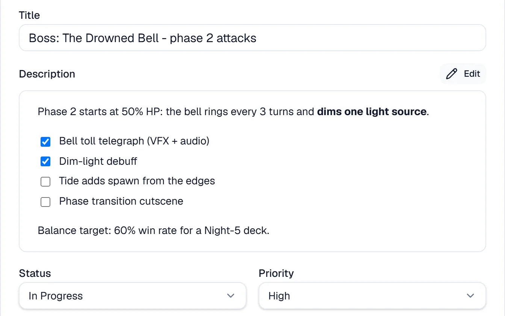
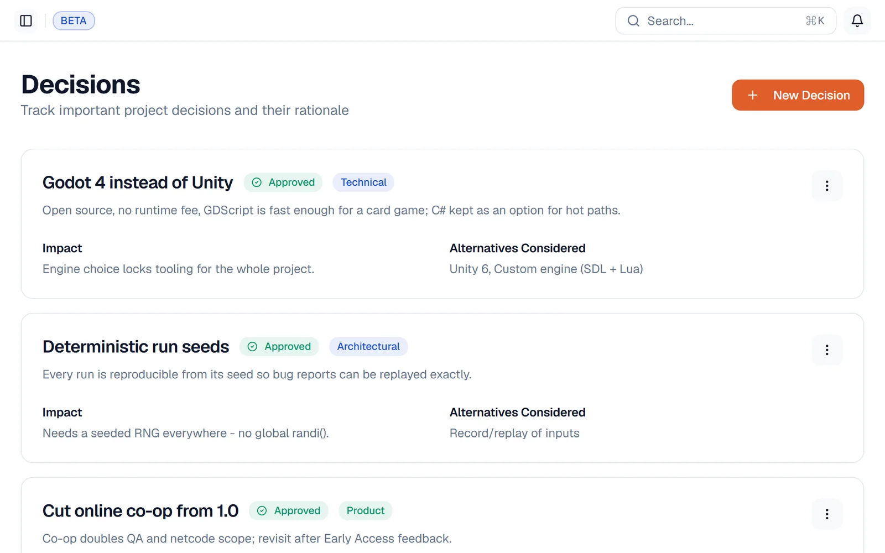
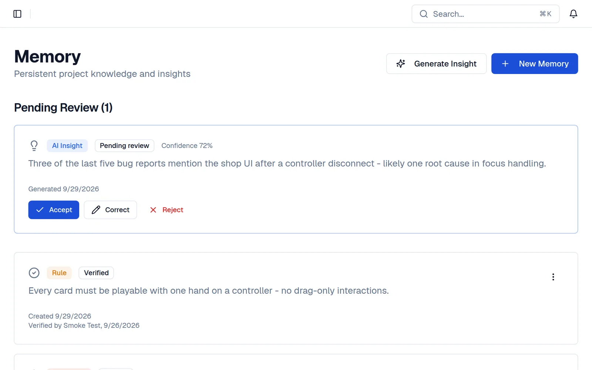

<div align="center">


**Project management that remembers why.**
Tasks, decisions and project memory in one place, built for game and software teams and the AI agents that work with them.

[Website](https://useguidon.com) ·
[Self-hosting](./docs/self-hosting.md) ·
[User guide](./docs/user-guide.md) ·
[API & MCP](https://useguidon.com/developers) ·
[Compare](https://useguidon.com/compare)

[](./LICENSE)
[](https://www.npmjs.com/package/@two_steps_studio/guidon-sdk)
[](https://skills.sh/two-steps-studio/guidon)

<picture>
  <source media="(prefers-color-scheme: dark)" srcset="./public/landing/taskBoard-dark.webp">
  
</picture>

</div>

## Why Guidon

Most boards track *what* is being done. Guidon also keeps *why*: the decision
behind a task, what was already tried, and what the team knows about the
project. People and AI agents read the same context, so nobody starts from
zero.

- **Task board.** Drag and drop, custom columns, labels, subtasks, recurring tasks, bulk actions and *My tasks* across projects.
- **Context behind the work.** Decisions, knowledge base, project memory, roadmap, calendar, whiteboard and moodboard. Each module can be switched on or off per project.
- **Built for AI agents.** A REST API ([OpenAPI](https://useguidon.com/openapi.json)) and an MCP server. Claude Code, Cursor, Codex and others can pick up a task, see earlier failed attempts, do the work and hand it back for review.
- **Where you already work.** Plugins for Unity, Unreal Engine, Godot, Blender, JetBrains and VS Code, a desktop app, a Discord bot and in-game bug reports.
- **Yours to run.** Self-host with Docker Compose on plain PostgreSQL, with local file storage and optional local AI (Ollama). No limits on a self-hosted instance.

<table>
<tr>
<td width="50%"></td>
<td width="50%"></td>
</tr>
<tr>
<td align="center">Decisions</td>
<td align="center">Project memory</td>
</tr>
</table>

## Get started

| | Guidon Cloud | Self-hosted | Development |
|---|---|---|---|
| For | Trying Guidon without running anything | Running it on your own server | Changing Guidon's code |
| Start | [Start free](https://useguidon.com/start) or [try the sandbox](https://useguidon.com/sandbox) | `./scripts/self-host.sh` | `npm install && npm run dev` |
| Details | [Pricing](https://useguidon.com/#pricing) | [docs/self-hosting.md](./docs/self-hosting.md) | [CONTRIBUTING.md](./CONTRIBUTING.md) |

### Self-host in one command

You need Docker with Compose.

```bash
git clone https://github.com/Two-Steps-Studio/guidon.git
cd guidon
./scripts/self-host.sh
```

The script writes a `.env` with random secrets, builds the image, runs the
migrations and waits until the app answers on
[http://localhost:3000](http://localhost:3000). Then sign up to create the first
account. Storage, AI, sign-in providers, backups and upgrades are covered in
[docs/self-hosting.md](./docs/self-hosting.md).

### Connect an AI agent

```bash
npx skills add two-steps-studio/guidon
```

That installs Guidon's task workflow skills (from [`skills/`](./skills/)). To
connect an MCP client, see the [agent integration guide](https://useguidon.com/developers).

## Tech stack

Next.js 16 (App Router, React 19), TypeScript, Tailwind CSS v4, shadcn/ui and
PostgreSQL. Pages read data in Server Components and write through Server
Actions. The same Row-Level Security policies guard the data on Supabase and
on a plain self-hosted PostgreSQL. More in
[docs/architecture.md](./docs/architecture.md).

## Repository layout

| Path | What's there |
|---|---|
| `src/` | The web app: pages, Server Actions, the `/api/v1` REST API and the MCP server |
| `src/db/migrations/` | Database schema, one numbered SQL file per change ([reference](./src/db/migrations/README.md)) |
| `plugins/` | Editor plugins: Unity, Unreal, Godot, Blender, JetBrains, VS Code |
| `desktop/`, `mobile/`, `discord-bot/` | Desktop app (Tauri), mobile app (Expo), Discord bot |
| `packages/`, `sdk/` | JavaScript SDK, CLI and Python SDK (MIT) |
| `skills/`, `agent-plugin/` | Skills and plugin for AI coding agents |
| `tests/` | Plain Node test scripts (`npm run test:*`) |
| `docs/` | Guides, architecture, audits and release notes |

## Documentation

- [User guide](./docs/user-guide.md): the main workflows in the web app
- [Self-hosting](./docs/self-hosting.md), [configuration](./docs/configuration.md), [upgrading](./docs/upgrading.md), [backups](./docs/backups.md)
- [Architecture](./docs/architecture.md)
- [Importing tasks](./docs/importing.md) from CSV, JSON and Trello
- [Webhooks](./docs/webhooks.md), [Context API](./docs/context-api.md), [custom modules](./docs/custom-modules.md)
- [Roadmap](./ROADMAP.md)

## Contributing

Bug reports, ideas and pull requests are welcome. Start with
[CONTRIBUTING.md](./CONTRIBUTING.md). Report security problems privately as
described in [SECURITY.md](./SECURITY.md), not in a public issue.

## License

The Guidon application is licensed under the
**GNU Affero General Public License v3.0** (`AGPL-3.0-only`, see
[LICENSE](./LICENSE)). You may run, study, change and self-host it. If you
offer a modified version to others over a network, you must share your
changes with them under the same licence.

The JavaScript SDK (`packages/sdk-js`), CLI (`packages/cli`) and Python SDK
(`sdk/python`) are MIT-licensed; each has its own `LICENSE`. The Guidon name
and logo are not covered by either licence (see
[useguidon.com/brand](https://useguidon.com/brand)).

Made by [Two Steps Studio](https://github.com/Two-Steps-Studio).
